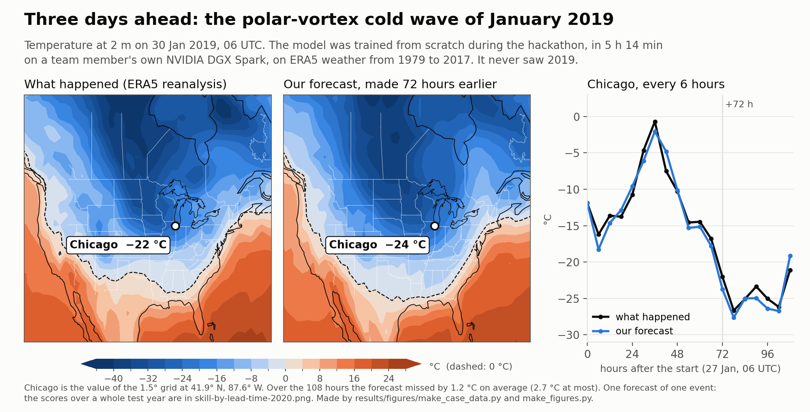
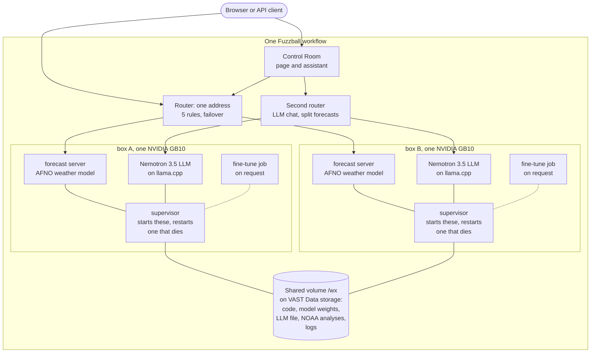
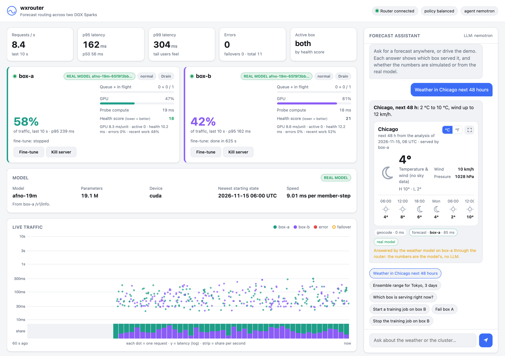
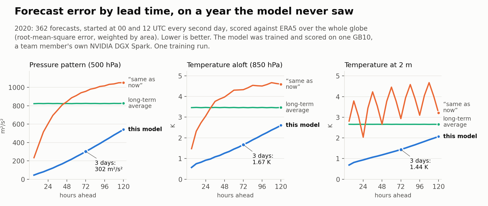
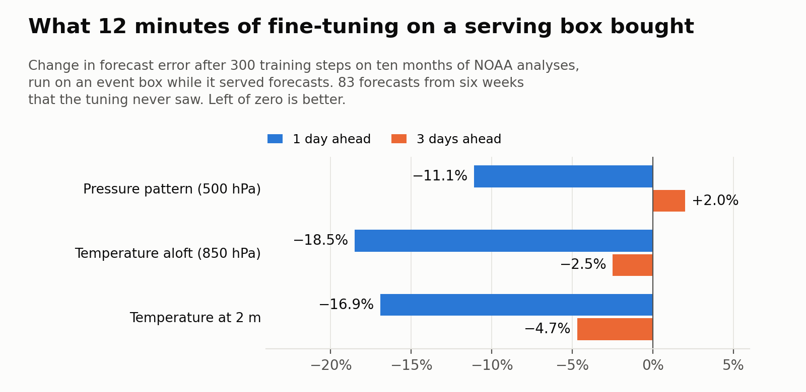
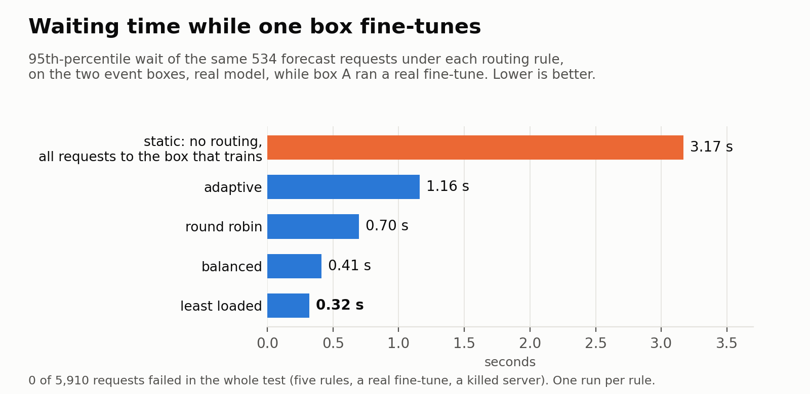

# wxrouter: a weather service on two desk-side GPU boxes that keeps answering while it learns

**Team 14 · CIQ × NVIDIA Supercomputing Local AI Hackathon · Chicago, Nov 13–15, 2026**<br>
Cory Gardner · Niravkumar Patel · Chandan Kumar · Ruthwik Reddy Adapala · Arin Mahapatra · Rayan Ahmed Khan

We trained a global weather model from scratch during the hackathon, in 5 hours 14 minutes on one NVIDIA
GB10. A router sends each request to the less loaded box and
retries on the other when one fails, and a supervisor on each box lets one GPU serve forecasts, keep
an LLM assistant ready and fine-tune the model at the same time. The service keeps answering while one
box fine-tunes the model, while a forecast server is killed, and while a new model goes live. One CIQ
Fuzzball workflow file starts all of it.

Measured on the event's two boxes on Nov 14, one run each:

- **0 of 5,910** requests failed in a test with a real fine-tune on one box and a killed forecast server
  on the other.
- **0.32 s instead of 3.2 s**: the wait that one request in twenty exceeds while a box fine-tunes, with
  the router's least-loaded rule and with no routing (0.41 s with `balanced`, the rule the stack starts
  with).
- **11 to 18% lower** 1-day forecast error after a 12-minute fine-tune on a box that was serving. At
  3 days one of the three scores is 2.0% worse.
- **0 of 465** requests failed while the tuned model went live and the base model went back, one box at
  a time.

Built on NVIDIA GB10, PhysicsNeMo and Nemotron, on CIQ Fuzzball, and on one shared volume on VAST Data storage:
[how we used each](#built-on-the-sponsors-platforms).



*The polar-vortex cold wave of January 2019 as it happened (left) and in a 72-hour forecast (right) from
the model we trained during the hackathon. The model learned from weather of 1979 to 2017 and never saw
2019; the forecast starts from the recorded weather of 27 Jan 2019. This case was chosen before the event
and is a standing check in our scoring script: earlier models of this recipe caught 88 to 97% of the
cold at 850 hPa (about 1.5 km up), this one 97.8%. "Chicago" is a value of the model's 1.5° grid, not a station reading. One event; the scores over a whole year are
[below](#the-weather-model-what-it-is-and-how-good-it-is).*

## The results in one table

| What we measured | Result | Where measured |
|---|---|---|
| Five routing rules, the same 1,182 requests each, with a real fine-tune on box A and box B's forecast server killed | **0 of 5,910** requests failed | event boxes |
| The wait that one request in twenty exceeds (p95) while a box fine-tunes: no routing, against the router's least-loaded rule | 3.2 s against **0.32 s**, the same 534 requests | event boxes |
| A fine-tune on a box that is serving (300 steps, 12 min, ten months of NOAA analyses) | 1-day errors down **11.1%, 18.5% and 16.9%** on 83 forecasts it never saw; at 3 days one of the three scores is 2.0% worse | event boxes |
| The tuned model goes live one box at a time, under traffic (and back to the base model) | **0 of 465** requests failed over the two swaps; each box back in 11 s | event boxes |
| Both forecast servers killed in turn under traffic | **0 of 298** requests failed; each server back by itself in 12 to 14 s | event boxes |
| One 20-member, 5-day forecast split evenly across both boxes | **2.0 to 2.2 s** against 4.2 s on one box | event boxes |
| One 48-hour forecast through the router | about **80 ms** | event boxes |
| The LLM (NVIDIA Nemotron 3.5 Lightning, 18.7 GB on the GPU) beside the weather model on one GPU | 55 to 56 tokens a second; a tool call in 2.2 to 2.3 s (no fine-tune running) | event boxes |
| A global weather model trained from scratch (NVIDIA PhysicsNeMo AFNO, 19.1M parameters) | **5 h 14 min** on one GB10, from the start to the scored model | a separate DGX Spark |
| Its 3-day forecast error on 362 forecasts of 2020, a year it never saw | **302** against 956 for "same as now" and 825 for the long-term average (the 500 hPa pressure pattern, the standard score for global weather models; lower is better) | same |

"Event boxes" are the event's two NVIDIA GB10 machines: Lenovo ThinkStation PGX (they report maker
`LENOVO`, model `30KL000EUS`, family `DGX Spark`), Fuzzball nodes CIQ-CHI-SPARK27 and CIQ-CHI-SPARK28. Method, caveats and raw files:
[results/event-boxes-2026-11-14.md](results/event-boxes-2026-11-14.md) (it says which of the morning's
numbers were read from the terminal and have no raw file). An index of every result folder,
with where each was measured: [results/README.md](results/README.md).

## Why this, and who it is for

A global forecast used to need a supercomputer. An AI weather model needs one GPU: ours computes a
48-hour forecast in about 80 ms on a desk-side box. So a group with two such boxes and no data centre can
run its own model, ask it as often as it likes, and keep its data on site.

ECMWF's operational model forecasts better than our one-night model does, and we say by how much below;
we did not measure ours against NOAA's model and do not claim to match it. The case for
a model of your own is that you can retrain it on your own data. That raises two problems, and they
should be the same for any model served this way, not only weather:

- **A model that serves gains from training on newer data.** Ours learned from one archive (ERA5) and
  starts from NOAA's analysis of the day. Twelve minutes of training on ten months of NOAA analyses
  cut its 1-day errors by 11 to 18%.
- **A box that is training is slow to ask.** With no routing, one request in twenty waited 3.2 s or more
  while the box trained.

With two boxes and nobody on call, the service has to do two things by itself and a third on one command.
On the event boxes:

1. **Keep answering when a forecast server dies.** 298 of 298 requests answered; the server back in 12
   to 14 s.
2. **Keep answering fast while a box learns.** 0.32 s (least-loaded rule) instead of 3.2 s, for the same
   534 requests.
3. **Take a new model under traffic.** 0 of 465 requests failed over two swaps (to the tuned model and
   back).

It is for a team with small hardware and a model that must serve and learn on it: a lab, a utility, a
county office, a field campaign. That is the case we built for; no such group has used it yet.

## How it works

What we set out to show is the loop: the same two boxes serve the model, retrain it on new data, and put
the retrained model into service, with the router steering around whichever box is busy. On Nov 14 each
step ran on the event boxes, started by hand; nothing chains them yet.



- **The router** ([router.py](router.py)) holds one address for both boxes. It has five rules (`static`,
  `round_robin`, `least_loaded`, `adaptive`, `balanced`), reads each box's health and load, and retries a
  failed request on the other box.
- **A supervisor on each box** ([serve/node_stack.py](serve/node_stack.py)) is a small program that
  starts the box's servers and restarts one that dies. It keeps the forecast server and the LLM server
  alive on the box's one GPU, and starts a fine-tune job on request. Fuzzball gives a GPU to one job
  (as we asked for it, `nvidia.com/gpu: 1`), so everything that needs the GPU lives inside one service.
- **The forecast server** ([serve/forecast_server.py](serve/forecast_server.py)) runs the weather model
  on the GPU from NOAA's newest global analysis (NOAA's estimate of the atmosphere's current state,
  published every 6 hours), which the stack fetches by itself at its start.
- **The Control Room** ([ui/](ui/)) shows both boxes live and has an assistant. A weather question about
  a city it knows goes straight to the weather model, with no LLM in between; for other places the LLM
  asks the model and the page checks the temperature and wind figures of the reply against the model's
  answer (a net, not a proof; its limits are [listed](results/chat-follow-ups-2026-11-14/README.md)).
  A plain command ("Fail box A", "Start a training job on box B") is carried out for real; rules in the
  page's code, not the LLM, decide what counts as a plain command.
- **The second router** ([router/](router/)) sends chat to the LLM on either box and can split one
  ensemble forecast across both GPUs. **WhatIf** ([whatif/](whatif/)) records telemetry every second and,
  when asked what is wrong, proposes likely causes with the evidence it looked at. Its accuracy on the
  real stack has not been measured.



*The Control Room with the real weather model and Nemotron, under light demo traffic (click to enlarge).
This picture is from a test stack on one GB10, a separate DGX Spark, taken on Nov 15: there both
"boxes" share one GPU, which is why both cards say "GPU busy". On the event cluster each box has its own
GPU. "Two DGX Sparks" in the header is the page's fixed text; `DGX Spark` is the family name the event's
Lenovo machines report.*

## Built on the sponsors' platforms

**CIQ Fuzzball 4.3.1 starts the whole system from one file**,
[fuzzball/30-real-stack.fz](fuzzball/30-real-stack.fz): 2 jobs and 5 services. It ran on the event boxes
on Nov 14, and every part was up 36 s after a start (images cached, volume filled). The file, trimmed
to its skeleton:

```yaml
version: v4
volumes:
  wx:                                   # one persistent volume, mounted at /wx in prep and in every service
    use: team14
    name: wxdesk
jobs:
  prep:                                 # brings the code on the volume up to date, checks the files
    image:
      uri: docker://nvcr.io/nvidia/pytorch:26.02-py3
  hold:                                 # keeps the services alive
    image:
      uri: docker://rockylinux:9
    policy:
      timeout:
        execute: 9h                     # a job ends after one hour unless it says otherwise
    depends-on:                         # a service starts only if a job depends on it
      - name: ui
        status: RUNNING
      - name: router2
        status: RUNNING
services:
  box-a:                                # box-b is the same, on the second GB10
    image:
      uri: docker://nvcr.io/nvidia/pytorch:26.02-py3
    depends-on:
      - name: prep
        status: FINISHED
    script: |                           # one GPU goes to one job, so one supervisor runs all three
      exec python serve/node_stack.py --name box-a \
        --serve forecast="python serve/forecast_server.py ..." \
        --serve llm="/wx/llama/llama-server --model /wx/models/NVIDIA-Nemotron-3.5-Lightning-30B-A3B-Q4_0.gguf ..." \
        --job finetune="python weather/finetune.py ..."
    resource:
      devices:
        nvidia.com/gpu: 1
  router:                               # one address for both boxes; reaches them by service name
    script: |
      exec python router.py --policy balanced ... --backend box-a=http://box-a:8001 --backend box-b=http://box-b:8002
  router2: ...                          # LLM chat to either box, split forecasts
  ui:                                   # the Control Room, behind Fuzzball's Connect button
    network:
      endpoints:
        - name: control-room
          type: path
          scope: group
    readiness-probe:
      http-get:
        path: /
        port: 8080
```

Three things we learned on Fuzzball 4.3.1 and wrote into that file (more in
[fuzzball/README.md](fuzzball/README.md)):

- On this cluster a job ends after one hour unless it carries its own time limit. Our stack ended at
  minute 60 before we knew; the hold job now carries one (9 hours), and on Nov 15 a stack
  ran past its first hour with it.
- A service starts only if a job depends on it. We proved it with a one-minute test workflow.
- One GPU goes to one job. So the forecast server, the LLM and the fine-tune of a box live in one
  service, under our supervisor.

| Sponsor | What we used | What it did, with a number | Where to look |
|---|---|---|---|
| **NVIDIA** | GB10, one per box | One GPU holds the weather model, an LLM that takes 18.7 GB of GPU memory, and a fine-tune at once. One 48-hour forecast: about 80 ms. The model was trained from scratch in 5 h 14 min on one GB10 (a separate DGX Spark) | [results](results/event-boxes-2026-11-14.md), [scores](results/figures/data/scores_overnight.json) |
| | PhysicsNeMo 2.2.2 (AFNO) in the NGC PyTorch container `nvcr.io/nvidia/pytorch:26.02-py3` | The weather model's architecture (19.1M parameters; the weights are ours) and the runtime of every GPU service, with 16-bit arithmetic on the GPU (bf16) for serving and fine-tuning | [weather/wx_common.py](weather/wx_common.py), [weather/train.py](weather/train.py) |
| | Nemotron 3.5 Lightning 30B-A3B (4-bit) on llama.cpp's CUDA build for arm64 | The Control Room's assistant, with tool calls. One LLM server runs on each box, with all layers on the GPU, and the chat can reach either one: 55 to 56 tokens a second, a tool call in 2.2 to 2.3 s | [ui/agent.py](ui/agent.py), [fuzzball/fetch_assets.sh](fuzzball/fetch_assets.sh) |
| **CIQ** | Fuzzball 4.3.1 workflow: jobs and services with `depends-on`, one GPU per box service, a persistent volume, an endpoint, a readiness probe, time limits; Rocky Linux 9 for the hold job and three of the six one-time jobs | Starts, orders and holds the whole system. The benchmarks run inside it with `fuzzball workflow exec`. A queued copy of the stack took both GPUs 23 s after the first one ended | [fuzzball/](fuzzball/README.md) |
| | The Fuzzball CLI in our tools | The launcher wraps the CLI (`check`, `setup`, `up`, `status`, `open`, `logs`, `redeploy`, `down`). The Control Room can show Fuzzball's workflow events and which workflow holds each of the team's GPUs. Both read the CLI, so they work when the page runs on a machine with a logged-in CLI; inside the deployed stack the page has no CLI and both are off | [deploy/fb.py](deploy/fb.py), [ui/events.py](ui/events.py), [ui/fuzzball_gpu.py](ui/fuzzball_gpu.py) |
| **Lenovo** | The event's two machines are Lenovo ThinkStation PGX: each reports maker `LENOVO`, model `30KL000EUS`, family `DGX Spark`. Fuzzball reports 20 Arm cores, 127.9 GiB of memory and one NVIDIA GB10 on each; the CPU and the GPU share the memory | Every "event boxes" number on this page was measured on them: serving, routing, the fine-tune, the model swap, the faults | [results](results/event-boxes-2026-11-14.md), [the node records](tests/fixtures_fuzzball_nodes.json) |
| **VAST Data** | The event's VAST storage, reached as one persistent Fuzzball volume mounted on both boxes. We used it through that volume only, not through VAST's S3 or database interfaces | The design rests on it. The 18.9 GB LLM file exists once (loaded in 13.9 s on box A). A killed forecast server reloaded its model from it and served again after 12 to 14 s. The tuned model went live on both boxes by re-pointing one link, and the base model went back the same way: 0 of 465 requests failed over the two swaps. At every start the first job runs `git pull` on the volume, so a restart is a redeploy | [fuzzball/30-real-stack.fz](fuzzball/30-real-stack.fz) |

## The weather model: what it is and how good it is

**What it is.** AFNO, a neural-network design for global grids from NVIDIA's PhysicsNeMo library, with
19,128,832 parameters and our own weights: a global grid at 1.5°, 20 variables, 6-hour steps, up to 5 days
ahead. We trained it from scratch on ERA5 (the European centre's record of past weather) from 1979 to 2017
with [weather/train.py](weather/train.py), overnight on Nov 13–14, on one GB10 (a separate DGX
Spark). It forecasts temperature, wind, pressure and geopotential. It has no rain or cloud output. The weights (77 MB) and their
scores are a [public release](https://github.com/CoryGardner/wxrouter/releases/tag/model-v1).

**How we tested it.** 362 forecasts through 2020, started at 00 and 12 UTC every second day, each scored
against ERA5 over the whole globe at 20 lead times from 6 to 120 hours. The score is the root-mean-square
error (the typical size of the miss), weighted by area. 2020 was not used for training; 2018 was the
validation year. Two baselines: "same as now" (the weather stays as it is; forecasters call it
persistence) and the long-term average for that day and hour (1979–2017; climatology). Our scores for
"same as now" agree with the ones WeatherBench 2 publishes for 2020 to within 0.15%.
Scorer: [weather/score.py](weather/score.py). Raw scores:
[results/figures/data/scores_overnight.json](results/figures/data/scores_overnight.json).



| Error (RMSE), 2020 | 1 day | 3 days | 5 days |
|---|---|---|---|
| 500 hPa geopotential (m²/s²): **model** / same as now / long-term average | **102** / 605 / 825 | **302** / 956 / 825 | **541** / 1,051 / 826 |
| 850 hPa temperature (K): **model** / same as now / long-term average | **0.92** / 3.05 / 3.47 | **1.67** / 4.33 / 3.47 | **2.60** / 4.59 / 3.46 |
| 2 m temperature (K): **model** / same as now / long-term average | **0.93** / 2.04 / 2.66 | **1.44** / 2.93 / 2.66 | **2.07** / 3.21 / 2.66 |

(A difference of 1 K is 1 °C. The zigzag of "same as now" in the third panel is day against night.)

**What the numbers say.**

- The model beats both baselines for all three variables at every one of the 20 lead times. At 3 days its
  500 hPa error is 68% below "same as now" and 63% below the long-term average. Its 5-day forecast of the
  500 hPa pattern is better than "same as now" is at 1 day (541 against 605).
- The result holds on a second year and for a second training. 2019 (360 forecasts) gives 296 / 1.66 /
  1.44 at 3 days. A model of the same recipe trained on Nov 10, before the event, scored 304 at 3 days, 0.7% away.
- In the January 2019 cold wave, the 3-day forecast caught 97.8% of the departure from normal over the
  Chicago region at 850 hPa, about 1.5 km up: forecast 240.9 K, ERA5 240.3 K, normal 266.6 K. (The
  figure at the top shows the same forecast at 2 m.)

**What they do not say.**

- This is one training run with one seed, and the yearly scores have no confidence interval. At 3 days
  the better baseline's error is 1.8 to 2.7 times the model's; the difference between runs of this recipe,
  seen before the event, is about 1%.
- 2020 was not used to fit the weights, but the recipe was chosen before the event with 2020 scores of
  earlier runs in view. We expect that effect to be small beside a gap of this size; we did not measure it.
- It is a small model trained in one night. At 3 days the leading operational and AI models have less
  than half its error for the 500 hPa pattern (WeatherBench 2 lists 137 for ECMWF's IFS HRES and 124 for
  GraphCast, against our 302, sampled slightly differently) and about 60 to 80% of its error for
  temperature. They run on a much finer grid and take far more compute. We do not claim to beat ECMWF or
  NOAA.
- The ensemble (10 or 20 members: the same forecast run from slightly different starting states) gives a
  range and a real workload. Its spread was not checked against observations.

**It can keep learning on the boxes that serve it.** The model learned from ERA5, but in service it starts
from NOAA's GFS analysis of the day, which is not the same product. A 12-minute fine-tune (a short extra
training run) on ten months of GFS analyses ([weather/finetune.py](weather/finetune.py)), run on event
box A while it served forecasts and held the LLM, closed part of that gap:



| 83 forecasts the tuning never saw, Oct 1 to Nov 11, 2026 | 1 day ahead (90% interval) | 3 days ahead (90% interval) |
|---|---|---|
| 500 hPa geopotential | −11.1% (−12.3 to −9.8) | +2.0%, worse (+1.0 to +3.0) |
| 850 hPa temperature | −18.5% (−19.7 to −17.2) | −2.5% (−3.6 to −1.5) |
| 2 m temperature | −16.9% (−17.6 to −16.2) | −4.7% (−5.5 to −3.8) |

The train, validation and test periods were split by date before anything ran, with a 3-day gap between training and validation. The
intervals come from a paired bootstrap that redraws the 42 test days 1,000 times. The setting is the best
of three we tried, chosen on the validation period; each trial also printed its test scores, so read the
3-day column as the best of three. "Better" means closer to NOAA's own analyses. The same fine-tune run
alone on the DGX Spark that morning gave the same 1-day gains (−11.1%, −18.4%, −16.9%). For the question
"will the 2 m temperature be 5 °C or more away from now, one day ahead?", F1 rose from 57.0% to 65.0%;
for "frost or not" the tuned model was no better (F1 96.3% to 96.2% at 1 day, 94.9% to 94.4% at 3 days).
These yes/no scores were computed on the separate DGX Spark from the weights tuned on the event box
([results/event-scores-2026-11-14](results/event-scores-2026-11-14/README.md)).
The tuned model was live for the swap test; the stack then went back to the base model. Full report:
[results/event-boxes-2026-11-14/finetune_report.md](results/event-boxes-2026-11-14/finetune_report.md).

## Serving while a box trains, loses a server or takes a new model

All of this was measured on the two event boxes with the real model on Nov 14
([results/event-boxes-2026-11-14.md](results/event-boxes-2026-11-14.md)).



- **Load balancing while a box learns.** Box A ran a real fine-tune. With every request sent to box A,
  one request in twenty waited 3.2 s or more. With the router's least-loaded rule the same figure for the
  same 534 requests was 0.32 s: ten times shorter. Most of that comes from using the second box at all
  (plain round robin: 0.70 s); the load-aware rule halves it again. The slow side was seen three
  times and the gain twice: 1.9 s against 0.25 s in an earlier run with a lighter mix, and 2.3 s
  without routing in a replay on one GB10 (no routed run there).
- **Redundancy.** We killed a forecast server under traffic, then the other: 298 requests sent, 298
  answered. The router retried on the other box, and each box's supervisor had its server back in 12 to
  14 s. Across the five-rule test (5,910 requests, a fine-tune and a kill under every rule) no request
  failed.
- **A new model under traffic, with no failed request.** The tuned model went live by pointing one link
  on the shared volume at the new weights and restarting one box at a time
  ([bench/swap_weights.py](bench/swap_weights.py)), and the base model went back the same way: 0 of 465
  requests failed over the two swaps, and each box was back in 11 s with the new model's version in its
  answers.
- **Two boxes on one job.** One 20-member, 5-day forecast took 4.2 s on one box and 2.0 to 2.2 s split
  evenly across both (7 of 8 runs were even after a fix), with the same answer to within 0.008 °C.
- **The LLM fails over too.** With one box's LLM server killed, 38 of 38 short chat requests sent through
  the second router were answered (the router was started by hand in that run; long or streamed replies
  and a chat in the page were not tested).
- **An assistant that did not act on a hint.** On 7 of 8 messages that only hinted at a change, the LLM
  tried to call the kill tool. The page's check refused all 7 and carried out the 4 plain commands.

Two results that did not go our way are in the same file. Our own `adaptive` rule was the slowest of the
four rules other than `static` (p95 1.0 s against 0.39 s for least loaded over the whole run; 1.16 s and 0.32 s in
the figure, which covers only the time of the fine-tune). And in the run without routing, box A was five
times slower for 45 seconds for a reason we have not found; the "ten times" above leaves those 45 seconds
out.

What we did not test: the failure of a whole box, and of the router itself, which is one process. We
killed server processes. Every event-box number is from one run.

## What was brought, what was built here, and what ran where

- **Brought.** Four things, all from one team member's work on this kind of weather model before the
  event: the training recipe (the settings that `weather/train.py` implements); the ERA5 training data,
  packed before the event (it is not in this repository, so the from-scratch training cannot be repeated
  from the repository alone); reference measurements, among them the scores of a model of the same recipe
  trained on Nov 10, which `weather/score.py` checks itself against (that model is not served and is not
  in this repository); and the container image with PyTorch and PhysicsNeMo that the training ran in.
  The public components under "Credits" were brought as they are.
- **Built at the event.** The code in this repository (first commit authored Nov 13, 11:33 PM); the weather
  model's code was written after kickoff, from that recipe. The model that the boxes serve was trained
  from scratch overnight on Nov 13–14 with `weather/train.py`, in 5 h 14 min, on a separate
  DGX Spark (one GB10, not one of the event's boxes).
- **Run on the event boxes.** Serving, routing, the fine-tune on NOAA analyses, the model swap and every
  measurement in [results/event-boxes-2026-11-14.md](results/event-boxes-2026-11-14.md). The from-scratch
  training was not run there.
- **Checked on one GB10 first, then on the event boxes.** The assistant's direct path to the weather
  model, the demo traffic's limit, and the last fixes to the page were tested with the real model and the
  real LLM on the separate DGX Spark on the night of Nov 14
  ([results/chat-follow-ups-2026-11-14](results/chat-follow-ups-2026-11-14/README.md),
  [results/one-gb10-2026-11-14-night](results/one-gb10-2026-11-14-night/README.md)), with their known
  limits listed there. On Sunday morning, Nov 15, the same code started on the event boxes and passed a
  short check there: the follow-up questions were answered by the weather model, a killed forecast server
  was back in 13.7 s with no failed request, and a fine-tune ran beside the forecasts
  ([results/event-boxes-2026-11-15](results/event-boxes-2026-11-15/README.md)).

## What is next

Repeat every event-box test (each number is one run). Find the cause of the 45 seconds in which box A was
five times slower. Fix or drop the adaptive rule. Keep the fine-tune from making the 3-day pressure score
worse. Check the ensemble's spread against observations. Test the failure of a whole box and of the
router.

## What is in this repository

| Where | What it is | State |
|---|---|---|
| [fuzzball/](fuzzball/README.md) | The Fuzzball workflow files. `30-real-stack.fz` is the whole system in one file; `quick/` holds the one-time jobs; `first-plan/` is the plan of Nov 13 | **`30-real-stack.fz` and the `quick/` jobs ran on the event boxes**; `31-one-gpu-stack.fz` has no recorded run; `first-plan/` was not run |
| [deploy/](deploy/README.md) | `fb.py`, the launcher around the Fuzzball CLI; the generated workflow files of the inference engine | `fb.py` starts the stack that ran on the event boxes; the generated workflows ran on the event machines |
| [router.py](router.py) | The router: one address, five rules, failover | deployed |
| [serve/](serve/) | The forecast server for one box and the supervisor that shares the box's GPU | deployed |
| [weather/](weather/) | The weather model's code: trainer, scorer, fine-tune, NOAA download | the forecast core, the fine-tune and the NOAA download are deployed; the trainer and the scorer ran on a separate DGX Spark |
| [ui/](ui/README.md) | The Control Room: the page, its assistant, the events feed, the demo traffic | deployed |
| [router/](router/) | The second router: LLM chat to either box, one forecast split across both | deployed |
| [whatif/](whatif/), [data/](data/) | WhatIf: the telemetry recorder and the diagnosis agents; `data/splits.json` is its list of recorded test cases | deployed with the page |
| [bench/](bench/) | The measurement scripts behind `results/` (fault table, fine-tune scene, model swap, split, pre-flight) | ran inside the stack |
| [results/](results/README.md) | What the measurements returned, with raw files. [results/figures/](results/figures/) holds the figures on this page, their data and the scripts that drew them (`python results/figures/make_figures.py results/figures/data results/figures`) | |
| [inference/](inference/README.md), [router_switching/](router_switching/README.md) | A second GPU inference engine and its benchmark; the switching API and threshold study for the page | the engine ran on the event machines as separate workflows (a stand-in model for the benchmarks, the trained model for one check); the threshold study is simulated on mock boxes |
| [tests/](tests/) | About 770 tests that need no PyTorch, and about 170 more for the weather model that need it (no test needs a GPU); the commands are in [docs/DETAILS.md](docs/DETAILS.md#tests) | |
| [API.md](API.md), [contract.py](contract.py), [docs/CONTRACT.md](docs/CONTRACT.md) | The request and response contract of a forecast server | |
| [mock_server.py](mock_server.py), [loadgen.py](loadgen.py), [dev_stack.py](dev_stack.py) | The laptop test bed the project began with: mock boxes with made-up timings and a seeded load generator | laptop test bed (the inference benchmark also uses `loadgen.py`) |
| [dashboard/](dashboard/), [agent/](agent/), [tools/](tools/) | A first dashboard, agent tools and a local test cluster from the first night; the tests still use them | not part of the demo (the second router still serves the first dashboard at its own `/`) |
| [docs/](docs/) | [DETAILS.md](docs/DETAILS.md): the routing rules, the laptop benchmark, the server and the tests in detail. [PROJECT.md](docs/PROJECT.md): the team's working document of Nov 14 | |
| [requirements.txt](requirements.txt), `.mcp.json`, `.claude/` | The four Python packages of the servers; two settings files for coding assistants | not part of the system |

## Try it

On a laptop, with mock boxes (no GPU and no model needed; the forecast numbers are made up):

```bash
uv venv .venv && uv pip install --python .venv/bin/python -r requirements.txt
.venv/bin/python dev_stack.py        # two mock boxes, the router and the Control Room at http://127.0.0.1:8080
```

On a Fuzzball cluster with two GPU nodes, a logged-in `fuzzball` CLI and a persistent volume (ours is
`wxdesk` on the provisioner `team14`; the names are in the workflow files). See
[deploy/README.md](deploy/README.md) and [fuzzball/README.md](fuzzball/README.md):

```bash
python deploy/fb.py setup     # once: fill the shared volume (code, packages, model, LLM, NOAA data)
python deploy/fb.py up        # start fuzzball/30-real-stack.fz and wait until Fuzzball shows its services running
python deploy/fb.py open      # the Control Room
```

More ways to run the pieces by hand, and the test commands, are in [docs/DETAILS.md](docs/DETAILS.md).

## Team

Team 14 is Cory Gardner, Niravkumar Patel, Chandan Kumar, Ruthwik Reddy Adapala, Arin Mahapatra and
Rayan Ahmed Khan.

| Area | Mainly by |
|---|---|
| The router and its five rules, the Control Room page, the laptop test bed, the launcher | Niravkumar Patel |
| The weather model, the forecast server, the supervisor, the Fuzzball stack, the second router, the assistant's checks, the measurements | Cory Gardner |
| The GPU inference engine, the switching API and threshold study | Chandan Kumar |
| WhatIf: telemetry and diagnosis agents; the assistant's direct path to the weather model | Ruthwik Reddy Adapala |
| The Connect button opening the Control Room, chat through the second router, the one-GPU stack | Arin Mahapatra |

In the commit history, Chandan Kumar's commits appear as "agentQ" and Niravkumar Patel's merges as
"milink17".

## Credits

- Weather model: NVIDIA PhysicsNeMo's AFNO (`nvidia-physicsnemo` 2.2.2); the weights are ours.
- LLM: NVIDIA Nemotron 3.5 Lightning 30B-A3B (4-bit GGUF), served by llama.cpp (release build b12359).
- Training data: ERA5 (Hersbach et al.), via WeatherBench 2. Generated using Copernicus Climate Change
  Service information [2026]. Neither the European Commission nor ECMWF is responsible for any use made of it.
- Starting weather and fine-tune data: NOAA GFS analyses, from NOAA's open data.
- Map outlines in the figures: Natural Earth (public domain).
- Platform: CIQ Fuzzball 4.3.1 on the event's NVIDIA GB10 boxes.
- FastAPI, uvicorn, httpx and pydantic for the servers.
- Most of the code and of the documentation was written with AI coding assistants (Claude Code among
  them; the commit trailers show where), directed and reviewed by the team. The design decisions and the
  measurements are the team's.
