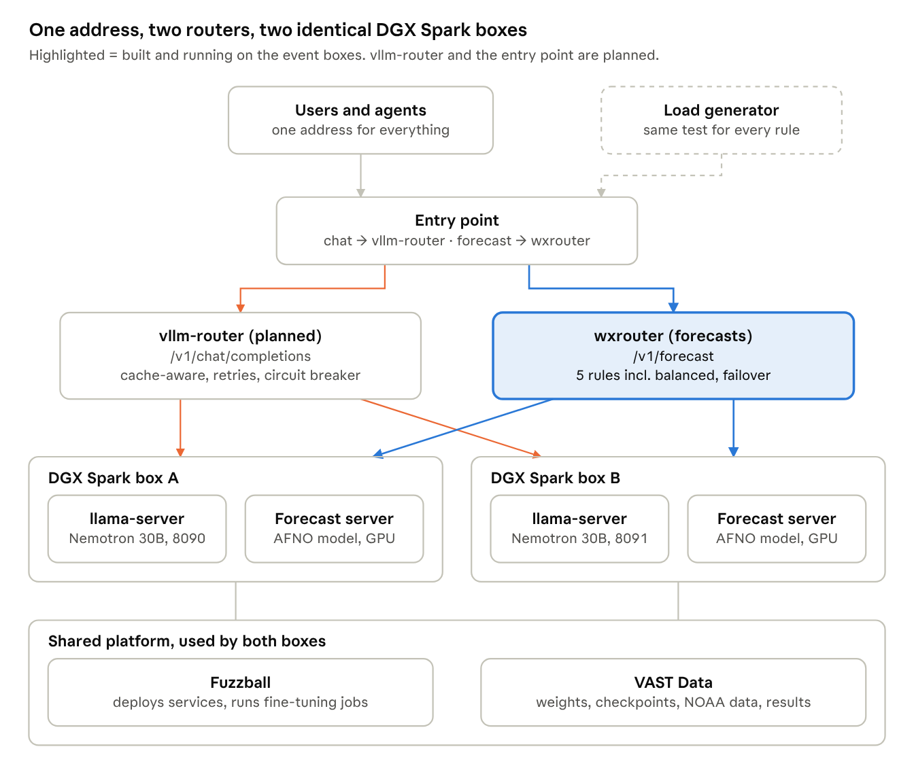
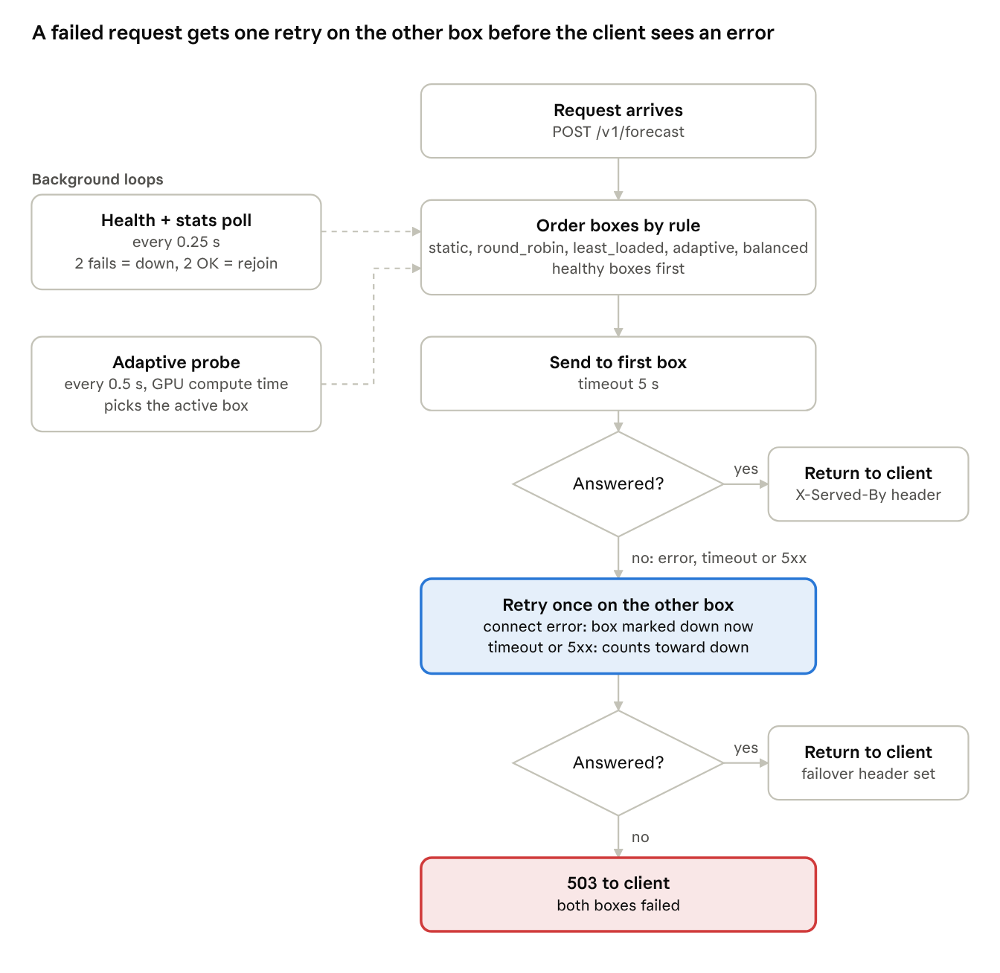
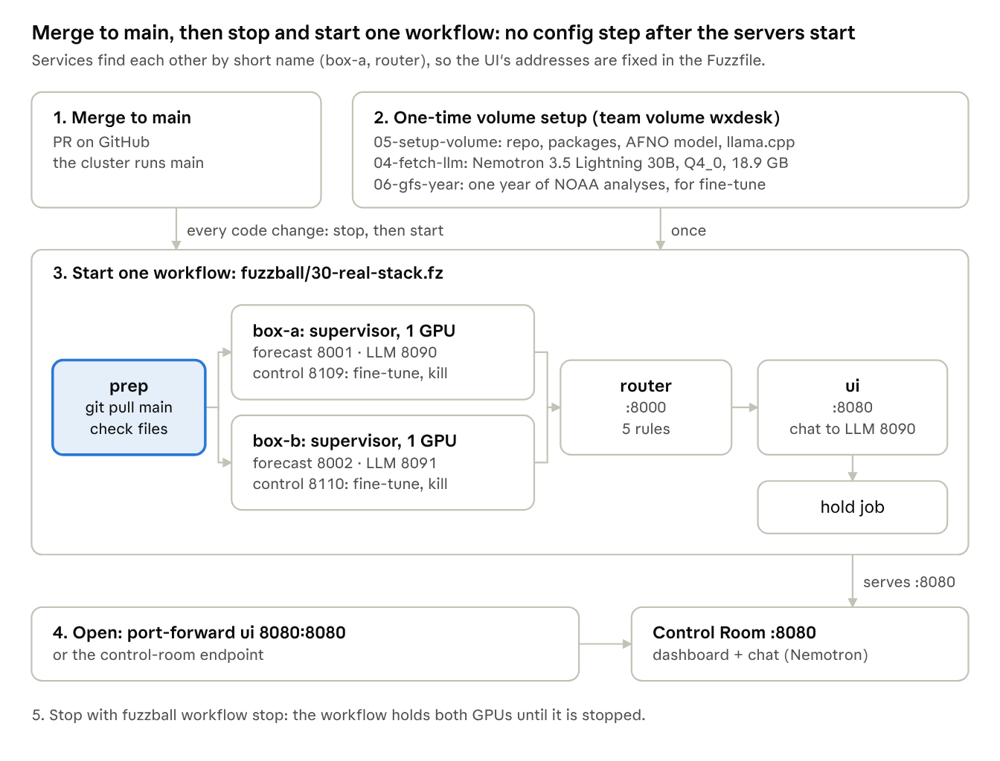

# wxrouter — Forecast Routing Across Two DGX Sparks

> **This is a copy** of the team's project doc, taken Nov 14, 2026. The live version, which may be newer, is
> at <https://claude.ai/artifact/4EQyR9HZiknTTh7FY3CFt3>. Edit that one and refresh this copy, so the two
> don't drift. The diagrams are images exported from the doc.

Nov 14, 2026 · Neal

## Overview

Users and agents talk to one address, and a router decides request by request whether DGX Spark box A or box B answers. Each box runs the same two services: an LLM (Nemotron 3.5 Lightning on llama.cpp) and the GPU weather model.

Built and merged so far (10 pull requests): the real AFNO weather model and GPU forecast server, Nemotron 3.5 Lightning 30B on llama-server on both boxes, the router with five rules and failover, one Control Room with forecast chat, a GPU inference subsystem, and a deploy script. The whole stack ran on the event boxes. Still open: multi-node training, vllm-router, and a real fine-tune beside serving.

| Piece | Status |
| --- | --- |
| API contract (`API.md`, `contract.py`) | v1.1: optional rain, 6-hour model steps |
| Real weather model (AFNO, 19.1M params) | Trained from scratch in 5 h 14 min; ~80 ms per 48-h forecast on an event box |
| GPU forecast server (`serve/forecast_server.py`) | Running on the event boxes behind the router |
| LLM: Nemotron 3.5 Lightning 30B on llama-server | Running on both event boxes; tool call 2.2 s at 55 tokens/s |
| Router (5 rules + failover) | Tested on the event boxes; balanced p95 197 ms at 15 req/s |
| Control Room (`ui/`, merged with `ui2/`) | Dashboard, forecast chat with weather cards, real fine-tune and kill buttons |
| GPU inference subsystem (`inference/`) | Batching engine, benchmarks, Fuzzball workflows |
| Deploy script (`deploy/fb.py`) | Menu over the fuzzball CLI; tested offline |
| Load generator + benchmark | Built, tested |
| Real fine-tune beside serving | Not yet measured; training data being built on the volume |
| vllm-router for LLM traffic | Planned, not tested |
| Multi-node training | Not started |

## Progress so far

Ten pull requests are merged into `main` of [7-c0ke/wxrouter](https://github.com/7-c0ke/wxrouter). The stack has run end to end on a laptop and on the two event boxes, with the real model and Nemotron.

| When | What | Result |
| --- | --- | --- |
| Nov 14 | [PR #10](https://github.com/7-c0ke/wxrouter/pull/10): deploy script `deploy/fb.py` | Menu over the fuzzball CLI: check, setup, up, open, logs, redeploy, down; 12 offline tests |
| Nov 14 | [PR #9](https://github.com/7-c0ke/wxrouter/pull/9) (teammate): chat safety | The assistant acts only on a command, never on a question |
| Nov 14 | [PR #8](https://github.com/7-c0ke/wxrouter/pull/8): ui2 merged into ui | One Control Room; five box buttons including real fine-tune and kill; `ui2/` removed |
| Nov 14 | [PR #7](https://github.com/7-c0ke/wxrouter/pull/7) (teammate): GPU inference subsystem | Batching engine, AFNO adapter, benchmarks, Fuzzball workflows |
| Nov 14 | Event boxes: LLM and assistant | Nemotron 30B loaded in 13.9 s; tool call 2.2 s at 55 tokens/s; chat forecast end to end in 9.4 s |
| Nov 14 | Event boxes: real stack | Real model ~80 ms per 48-h forecast; kill under traffic 298/298 answered; balanced p95 197 ms at 15 req/s |
| Nov 14 | [PR #6](https://github.com/7-c0ke/wxrouter/pull/6): weather card in chat | Card with °C/°F and a full-forecast view; rain optional; 6-hour model steps marked |
| Nov 14 | [PR #5](https://github.com/7-c0ke/wxrouter/pull/5): balanced routing ("Both") | Per-request health score; best p95 and p99 in the laptop bench, 0 errors |
| Nov 14 | [PRs #3](https://github.com/7-c0ke/wxrouter/pull/3), [#4](https://github.com/7-c0ke/wxrouter/pull/4) (teammate): Switchyard | Real weather model, GPU forecast server, NOAA fine-tune, per-box supervisor, MCP agent, Fuzzball setup jobs |
| Nov 14 | First Fuzzball run (mock stack) | Boxes, router, UI and a hold job ran; scene 3 switch with 0 errors |
| Nov 14 | [PR #2](https://github.com/7-c0ke/wxrouter/pull/2): Control Room UI | Dashboard and agent chat; UI service in the Fuzzball workflow; hold job keeps services alive |
| Nov 14 | [PR #1](https://github.com/7-c0ke/wxrouter/pull/1): Fuzzball deployment | Fuzzfile generator; code embedded so the private repo needs no token |
| Nov 14 | First commit | API contract, mock server, router with 4 rules, seeded load generator |

## Component diagram



Chat requests go through vllm-router (orange lines) and forecast requests go through wxrouter (blue lines). Each router can send a request to either box.

## Components

Every server speaks the same API, so the mock and the real GPU server swap by changing a URL. The `router/` and `dashboard/` folders are a teammate's parallel versions, kept as a cross-check; the main ones are `router.py` and `ui/` (`ui2/` is merged into `ui/`).

| Component | File | What it does |
| --- | --- | --- |
| Weather model | `weather/` | NVIDIA PhysicsNeMo AFNO, 19.1M parameters, trained from scratch (`train.py`); scorer, NOAA GFS download, fine-tune with a held-out test (`finetune.py`) |
| GPU forecast server | `serve/forecast_server.py` | The model on one box's GPU. Answers the team contract; `--mock` runs without a model. Gives temperature, wind and pressure; no rain, humidity or cloud |
| Node supervisor | `serve/node_stack.py` | One per box, holding its only GPU: keeps the forecast server and llama-server alive, starts fine-tunes, handles kills (port 8109 / 8110) |
| LLM | llama-server + Nemotron 3.5 Lightning 30B (Q4_0) | OpenAI-compatible chat with tool calls, on each box (8090 / 8091); the chat uses box-a's |
| Mock forecast server | `mock_server.py` | Same API with no GPU. 6-hour model steps with interpolation, optional rain, `/admin/mode` for demo scenes |
| Router | `router.py` | One address for both boxes: static, round robin, least loaded, adaptive, balanced. One retry on the other box; `X-Served-By` |
| Control Room | `ui/` | Dashboard (KPIs, box cards with health score and five actions, traffic chart, events) and forecast chat with weather cards |
| GPU inference subsystem | `inference/` | Batching engine, AFNO adapter, benchmarks and their Fuzzball workflows |
| Load generator | `loadgen.py` | Seeded request stream, scheduled faults, p50/p95/p99 per rule |
| Fuzzball deploy | `deploy/fb.py`, `fuzzball/` | Deploy script (menu over the CLI); the real-stack workflow and the one-time setup jobs |
| Tests | `tests/` | Unit and end-to-end tests for the model tools, server, router, agent, dashboard and deploy script |

## Request flow



A 4xx (bad input) counts as answered and goes straight back, since retrying it would fail the same way. The two background loops run on their own and never slow a request down.

## Routing rules

All five rules share failover: a request that fails on one box is retried once on the other. You can switch rules at runtime with `POST /router/config`, or from the Control Room. There, the rule buttons are the switch. The home box (for adaptive and static) is its own setting and never changes the rule. Advanced settings has a slider for each adaptive setting and a reset. Each box card has a Drain toggle. The page builds these controls from `GET /router/config`, so box names and ranges are not hard-coded.

| Rule | Picks | Good at | Weak at |
| --- | --- | --- | --- |
| `static` | Always box A | Baseline. Easy to reason about. | Suffers fully when A is slow. |
| `round_robin` | Takes turns | Even spread | Keeps sending half the traffic to a sick box. |
| `least_loaded` | Fewest in flight (router count + box queue) | Low p50/p95 when both boxes are healthy | Ignores errors and how fast each box is. |
| `adaptive` | One active box, moved rarely; returns to the preferred box | Scene 3: moves off a slow box once, no bouncing | Higher tail while a backlog drains. |
| `balanced` | Both boxes, per request, by health score | Best p95/p99 in testing; sees slowness, errors and load at once | Needs a little traffic on both boxes to keep scores current. |

**How adaptive decides**

- Every 0.5 s the router sends a small probe forecast (12 h) to each box. It does not wait for the replies.
- The score is the box's own GPU compute time from the reply (`timing.compute_ms`), not the round trip. A round trip includes queueing behind the router's own traffic, which made the busy box always look worse. That bug caused a needless switch in testing.
- A probe stuck for more than 1 s (`--stall-ms`), or rejected with 503, counts as a slow box. This catches a box whose queue is backing up.
- **Leave** the active box when the other one is at least 25% faster (`margin`) for 1 s straight (`window_s`), and at least 10 s after the last switch (`cooldown_s`).
- **Return home:** with `--preferred box-b`, traffic starts on B and goes back once B is healthy and no more than 20% slower than the active box (`return_margin`) for 1 s. The gap between "25% faster to leave" and "within 20% to return" stops it bouncing.
- **Dead box:** if the active box goes down, the switch is immediate, with no window or cooldown.

Tuning flags: `--margin 0.25 --window 1 --cooldown 10 --preferred box-b --return-margin 0.2 --stall-ms 1000`.

**How balanced decides**

For each request, every box gets a health score (lower is better). The router picks a box at random with weight 1/score², so the better box takes most of the traffic but the other keeps enough for its numbers to stay current.

```math
\text{score} = \left(t_{\text{unit}} \times (1 + a) + t_{\text{health}}\right) \times (1 + 5e) \times h
```

| Input | Meaning | Source |
| --- | --- | --- |
| t_unit | GPU ms per work unit (6 forecast hours × 1 member) | The box's own `timing.compute_ms` ÷ units, smoothed |
| a | Active requests | Router in-flight + box queue, ÷ max concurrency |
| t_health | Health-check time, ms | Round trip of `GET /health`, polled every 0.25 s |
| e | Error rate | Decaying share of recent errors and timeouts |
| h | Work history, 0.75 to 1.5 | Above 1 when the box did more than its share of work in the last 30 s |

Each box card in the Control Room shows its score and these parts. LLM token counts will join the work history once LLM traffic also goes through a router (today the chat calls box-a's LLM directly).

## API contract (v1.1)

The real server and the mock both implement these endpoints. The router exposes the same `POST /v1/forecast`.

| Endpoint | Who | Purpose |
| --- | --- | --- |
| `POST /v1/forecast` | servers, router | Request: `lat`, `lon`, `hours_ahead` (1–120), `step_hours` (1–24), `ensemble_members` (1–20), `request_id`. Response: points every `step_hours`, `low_confidence` past 72 h, ensemble mean plus members, and `timing` (queue, compute, total ms). |
| `GET /health` | servers, router | Cheap, never touches the GPU. Returns 200 `ok` or `degraded`, or 503 `down`. |
| `GET /stats` | servers | `in_flight`, `queue_depth`, `max_concurrency`, `gpu_util`, EWMA/p50/p95 latency, `mode` (real server: `normal` or `training`). |
| `POST /admin/mode` | mock only | `normal`, `slow` (× factor), `error` (503) or `hang`. |
| `GET /router/status`, `GET`/`POST /router/config` | router | Shows or changes the rule, adaptive settings, home box, drain, and reset; the status adds the switch log and failovers. `POST /router/policy`, `POST /router/drain` and `GET /router/health` are accepted too, as in `router/router.py`. |

A forecast has no side effects, so the router can safely retry it on the other box. It retries on connection errors, timeouts and 5xx responses. Errors 422 (bad input) go straight back to the client.

The router adds these response headers: `X-Served-By`, `X-Router-Policy`, `X-Router-Attempts`, `X-Router-Failover`.

**What v1.1 changed** (backward compatible with v1.0 clients that handle a null `precip_mm`):

- `precip_mm` is optional. The real AFNO model has no rain output, so it always sends `null`. New optional fields: `humidity_pct` and `cloud_pct`.
- `native_step_hours` (6): the model computes every 6 hours, and hourly points in between are straight-line interpolations. Clients treat a point as a model step when `lead_hours % native_step_hours == 0`.
- `GET /router/metrics` gives rolling per-box stats for the dashboard, and `GET /router/status` shows each box's health score.

## Demo scenes

Each scene can be rehearsed on a laptop with the mock before it runs on the boxes.

| Scene | What the audience sees | Status |
| --- | --- | --- |
| 1. A box fails and nobody notices | Stop box B during traffic. Everything goes to A, no request fails, and B rejoins when it comes back. | **Done on the event boxes:** both forecast servers killed in turn under 5 req/s; 298 of 298 answered, back in 12–14 s. In the Control Room: the "Kill server" button. |
| 2. One big job on two boxes | A 20-member ensemble is split 10 + 10 across the boxes and finishes in about half the time. | Works in the teammate's router (`router/router.py`): 809 ms vs about 1,600 ms of GPU work. Not yet in `router.py`. |
| 3. Training and serving at once | Fine-tuning on B slows it down. Traffic moves to A once, without bouncing, and returns to B when the job ends. | Switch confirmed on the cluster with slow mode (69 ms vs 1001 ms, 0 errors). The real fine-tune button is built; a real fine-tune beside serving is still to be measured, then the one-box-at-a-time model swap. |

To rehearse on a laptop, run `python dev_stack.py` and use the box buttons (Normal / Training / Fail) or ask the chat ("Start a training job on box B"). The teammate's `fuzzball/40-train-beside.fz` runs a real training job beside the servers for scene 3 on the cluster.

## Benchmark results (laptop, mock servers)

No rule dropped a request, even when a box was killed. With a 1 s window, adaptive comes closest to least_loaded on p95 and has the best tail of the rules that move traffic off a sick box. These numbers come from the mock's cost model, so rerun on the real boxes before deciding.

Test: seed 42, 987 requests over 40 s (25 req/s). Box A slowed 4× from 6–18 s, then box B killed at 24 s and restarted at 30 s.

| Rule | Errors | p50 ms | p95 ms | p99 ms | Box A % | Box B % | Failovers | Switches |
| --- | ---: | ---: | ---: | ---: | ---: | ---: | ---: | ---: |
| static | 0 | 206 | 5294 | 5810 | 76 | 24 | 77 |  |
| round_robin | 0 | 127 | 3349 | 4764 | 58 | 42 | 7 |  |
| least_loaded | 0 | 107 | 408 | 1104 | 52 | 48 | 3 |  |
| adaptive, 3 s window | 0 | 196 | 4425 | 5969 | 64 | 37 | 42 | 2 |
| adaptive, 1 s window (new default) | 0 | 175 | 674 | 2928 | 61 | 39 | 5 | 2 |

**Scene 3 rehearsal** (15 req/s, box B preferred, B slowed 2× from 8–22 s): with the 1 s window, adaptive left B once, about 2 s after training started, because B's compute time rose (96 ms vs 57 ms). Traffic returned to B about 3 s after training ended. There were 2 switches and 0 errors, and p95 was 569 ms.

**What testing changed:**

- The first adaptive version compared round-trip times. The busy box always looked slower than the idle one, so adaptive switched before anything was wrong. It now compares GPU compute time.
- A box with a full queue rejected probes instantly with 503, and the router ignored those, so the box looked healthy. Rejected or stuck probes now count as slow.
- Under a harsh 4× slowdown, a 3 s window let a backlog build (p95 4.4 s). A 1 s window cut p95 to 0.67 s with no extra switches.

**Five-rule comparison with balanced** (seed 42, 586 requests over 30 s at 20 req/s; box A slowed 4× from 4.5 to 13.5 s, box B killed at 18 s and restarted at 22.5 s). Every rule had 0 errors.

| Rule | p50 ms | p95 ms | p99 ms | Box A % | Box B % |
| --- | ---: | ---: | ---: | ---: | ---: |
| static | 192 | 5654 | 5880 | 73 | 27 |
| round_robin | 122 | 2478 | 2966 | 65 | 35 |
| least_loaded | 98 | 380 | 1090 | 50 | 50 |
| adaptive | 117 | 2483 | 3819 | 63 | 37 |
| **balanced** | 100 | **350** | **758** | 52 | 48 |

While box A was slowed, balanced sent it 18% of the traffic (least_loaded sent 29%), and p95 in that window was 492 ms vs 821 ms. After box B came back, its recent errors kept its share low until they decayed.

On the event boxes (real model, 15 req/s, no faults; see `results/event-boxes-2026-11-14.md`): balanced p95 197 ms, least loaded 187–200 ms, round robin 179–193 ms, adaptive 13–15 s. One GB10 can't carry 15 req/s alone, so a rule that keeps one active box builds a queue.

## Deployment flow

No config step after the servers start. Every part of the stack runs in **one** Fuzzball workflow (`fuzzball/30-real-stack.fz`), where services reach each other by short names (`box-a`, `router`). So the UI's addresses are fixed in the Fuzzfile ahead of time. Redeploying means stop, then start: the workflow's first job pulls the latest `main`.



The start order follows `depends-on`: each box waits for `prep` to finish, the router waits for both boxes, and the UI waits for the router.

**One script for all of it:** `python deploy/fb.py` opens a menu (check, setup, up, status, open, logs, redeploy, down). Or name the action, e.g. `python deploy/fb.py up` validates, starts and waits for `box-a`, `box-b`, `router` and `ui`. Only the real stack is deployed (no mock target), and `--dry-run` prints the fuzzball commands without running them.

| Phase | Run | What it does | How often |
| --- | --- | --- | --- |
| 0. Merge | PR into `main` on GitHub | The cluster runs whatever is on `main`; nothing is copied by hand | Every change |
| 1. Volume setup | `quick/05-setup-volume.fz` | Clones the repo to `/wx/repo`; Python packages to `/wx/pydeps`; weather model (77 MB), llama.cpp, today's NOAA analysis | Once |
| | `quick/04-fetch-llm.fz` | Nemotron 3.5 Lightning 30B (Q4_0, 18.9 GB) to `/wx/models`; resumable, checksummed | Once |
| | `quick/06-gfs-year.fz` | One year of NOAA GFS analyses (1.7 GB) for the fine-tune | Once |
| 2. Start | `fuzzball workflow start -n real-stack fuzzball/30-real-stack.fz` | `prep` pulls `main` and checks files, then `box-a` + `box-b`, then `router`, then `ui`, then `hold` | Each deploy |
| 3. Open | `fuzzball workflow port-forward <id> ui 8080:8080` | Control Room at http://localhost:8080 (or the `control-room` endpoint) | Each session |
| 4. Stop | `fuzzball workflow stop <id>` | Frees both GPUs; the workflow holds them until stopped | When done |

**What each box service runs.** One supervisor (`serve/node_stack.py`) per box holds the box's only GPU. It keeps three things alive: the forecast server (8001 / 8002), llama-server with Nemotron (8090 / 8091), and its own control API (8109 / 8110), which starts fine-tunes and handles kills.

**What a change needs**

| Change | Redeploy? | Steps |
| --- | --- | --- |
| UI, router or server code | Yes | Merge to `main` → stop → start (`prep` pulls `main`) |
| Routing rule or preferred box | No | Control Room or `POST /router/config` while running |
| Weather model weights | Yes | Re-run the setup job that writes `/wx/bundle`, then stop → start |
| A fine-tuned model | No restart of the workflow | Fine-tune from the box card; then kill one box's server at a time so the supervisor reloads it |
| Ports or service names | Yes | Edit `30-real-stack.fz` (router `--backend`, UI `--box` / `--stack` / `--llm-base-url`), then `fuzzball workflow validate` and start |

One cost: any code change restarts the whole workflow, including reloading the 18.9 GB LLM onto both GPUs. A separate workflow for the UI could avoid that, but it would need cross-workflow addresses (endpoints) instead of short names.

## LLM routing, deployment and open questions

Use [vllm-router](https://github.com/vllm-project/router) for LLM traffic and keep wxrouter for forecasts. vllm-router is a Rust router for OpenAI-compatible LLM endpoints. Its docs only show `/v1/chat/completions` and never mention custom paths like `/v1/forecast`.

| Topic | Status |
| --- | --- |
| LLM server | **Running on both event boxes:** Nemotron 3.5 Lightning 30B-A3B (Q4_0, 18.9 GB) on llama.cpp b12359, started by each box's supervisor on 8090 / 8091. Load 13.9 s; 18.7 GB GPU memory beside 0.4 GB for the forecast server; tool call 2.2 s at 55 tokens/s. The chat uses box-a's; a chat forecast took 9.4 s end to end. |
| LLM routing | vllm-router with `cache_aware` or `sticky_least_loaded`, health check at 1–2 s. Not tried; the chat calls one LLM directly today. |
| Entry point | One address: `/v1/chat/completions` to the LLM router, `/v1/forecast` to wxrouter. Not built yet. |
| Deployment ([Fuzzball](https://ciq.com/products/fuzzball)) | `fuzzball/30-real-stack.fz` ran on the event boxes (CIQ-CHI-SPARK27/28); `deploy/fb.py` wraps it. See the deployment flow above. |
| Data ([VAST Data](https://www.vastdata.com/)) | Planned for weights, NOAA data and results. Today a shared Fuzzball team volume (`wxdesk`) holds the repo, model, LLM and data; VAST specifics not confirmed. |

Open questions:

- [x] Does Fuzzball give each service a stable address?
  Yes. Short service names resolve inside a workflow (`box-a` → `box-a.<workflow>.<group>.fuzzball`).
- [x] Scene 2: should the router split ensembles?
  Yes. The teammate's router does it (10 + 10 members). It still needs to move into `router.py`.
- [x] Start Nemotron on llama.cpp on both boxes.
  Done: Q4_0, context 65,536, 4 parallel slots, same build on both boxes.
- [x] Keep one Control Room.
  `ui/`, with `ui2/` merged in ([PR #8](https://github.com/7-c0ke/wxrouter/pull/8)).
- [ ] Measure a real fine-tune beside serving (scene 3 with a real job) once the NOAA year is on the volume.
- [ ] Run `loadgen.py bench` with its faults on the event boxes.
- [ ] Does vllm-router work in front of `llama-server`, and can it forward `/v1/forecast`?
- [ ] Confirm the old mock-stack workflow `f81cfa72` has stopped (this Mac could not reach the API).
- [ ] Do both boxes mount VAST through the same path or the same S3 bucket?

Sources: [vllm-project/router README](https://github.com/vllm-project/router), [CLI reference](https://github.com/vllm-project/router/blob/main/docs/cli_reference.md), [load balancing docs](https://github.com/vllm-project/router/blob/main/docs/load_balancing/README.md). Fuzzball and VAST roles are a plan; their docs have not been checked yet.
